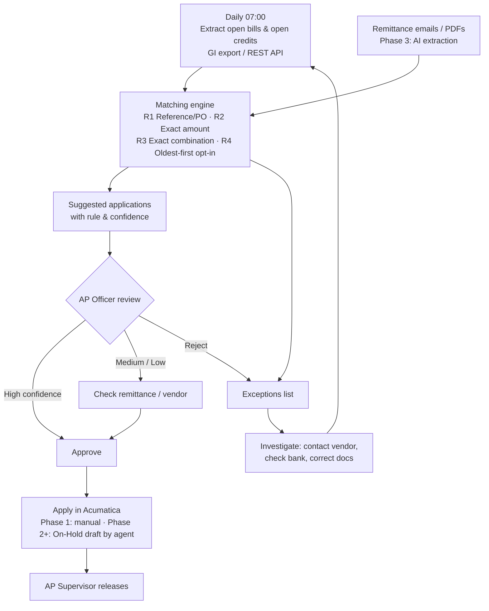

# SOP: AI-Assisted AP Offset in Acumatica

| Item | Detail |
|---|---|
| Document status | **DRAFT – Proposal for review** |
| Process owner | Finance Controller |
| System | Acumatica ERP – Accounts Payable (AP) |
| Tool | `tools/ap_offset` (phase 1 prototype) |
| Related SOPs | Payment Authorisation, Automated Bank Entries (Acumatica), Month-End Close |
| Version | 0.1 |

---

## 1. Purpose and Scope

**AP offset** means applying a vendor's open credit documents to that vendor's open bills, so that AP ageing and vendor balances are correct.

| In scope | Acumatica documents |
|---|---|
| **A. Payments → bills.** The payment is released but unapplied, or only partly applied. | AP Payment → Bill |
| **B. Prepayments and debit adjustments → bills.** | AP Prepayment / Debit Adjustment → Bill |

Out of scope: netting AP against AR for vendors that are also customers, and AP-to-AP transfers between vendors.

## 2. Principle: the agent proposes, a person approves, Acumatica posts

- The agent **never releases** anything in Acumatica. Its access is limited to reading, and from phase 2 also creating applications that stay **On Hold**.
- Amounts, balances and eligibility are checked by **fixed program rules**. AI is used only where data is unstructured, such as remittance advices, supplier statements and inconsistent references (phase 3).
- Every proposal records the **rule used, its confidence and the source**, so it can be audited.

## 3. Process Flow

## 4. Matching Rules

| Rule | Logic | Confidence | Reviewer action |
|---|---|---|---|
| R1 | The payment or credit memo quotes the bill number or vendor invoice number, or the PO number is the same | High | Approve after a quick check |
| R2 | One open bill has exactly the same amount (if several do, the oldest is chosen) | High / Medium | Medium: confirm which bill using the remittance |
| R3 | Exactly one combination of 2–5 bills adds up to the amount | Medium | Confirm with the remittance or vendor statement |
| R4 | Oldest due date first (only when switched on) | Low | Only with the vendor's confirmation |
| — | No match, several possible matches, or an amount left over | Exception | Investigate |

Bills and credits are only matched if they have the same **vendor and currency**, and the same branch when both have one. A bill is never applied above its open balance.

## 5. Roles

| Role | Responsibility |
|---|---|
| AP Officer | Runs the tool (or watches the scheduled run), reviews suggestions, marks Approved Y/N, applies approved items (phase 1), works on exceptions |
| AP Supervisor / Finance Manager | Releases the applications. Must be a different person from the one who approved the suggestion |
| Finance Controller | Owns the matching rules and approves changes to them. Reviews the monthly KPIs |
| IT / Acumatica Admin | Sets up the Generic Inquiries, the API connection and the restricted user for the agent |

## 6. Phased Rollout

| Phase | Agent capability | Posting | Exit criteria |
|---|---|---|---|
| **1. Read-only** (now) | Prototype `tools/ap_offset` works from Generic Inquiry CSV exports and produces suggestions and exceptions | Done by hand by the AP Officer | 4 weeks with High-confidence accuracy ≥ 98% |
| **2. Draft mode** | Pulls data through the Acumatica REST API (contract-based endpoint, OAuth connected app) and creates applications **On Hold** for approved rows | Released by the AP Supervisor | 1 close cycle with no posting errors |
| **3. AI-assisted** | An AI model (with tool calling) reads remittance advices from the AP mailbox and vendor statements, pulls out the invoice references, handles inconsistent reference formats, and drafts the reasons for exceptions | Same as phase 2 | Exceptions reduced by an agreed percentage |

## 7. Controls

| Ref | Control | Type | Evidence |
|---|---|---|---|
| APO-C1 | The agent's API user can read and create On-Hold documents only. It has no release rights and no access to vendor master data or bank details | Preventive | Role configuration; quarterly access review |
| APO-C2 | Every application is approved by a person before release, and the approver is not the releaser | Preventive | Suggestions file with Approved column; Acumatica audit history |
| APO-C3 | Medium and Low confidence rows need supporting evidence (remittance or vendor statement) attached or referenced | Preventive | Note column / document attachment |
| APO-C4 | Changes to rules and code are approved by the Controller and version-controlled in this repository | Preventive | Git history / pull request approval |
| APO-C5 | Exceptions older than 30 days are escalated to the Finance Manager | Detective | Exceptions log |
| APO-C6 | Monthly sample of 10 released applications re-checked against the remittance | Detective | Test sheet |
| APO-C7 | Monthly reconciliation of the AP sub-ledger to the GL, and review of the unapplied payments / prepayments ageing | Detective | Signed reconciliation |

## 8. KPIs

- Share of credits matched automatically (R1–R3)
- Accuracy of High-confidence suggestions (target ≥ 98%)
- Value and age of unapplied payments and prepayments
- Number of exceptions and average days to resolve

## 9. Open Decisions

1. Whether R4 (oldest due first) is allowed at all, and if so, for which vendors.
2. Whether the API can be used in phase 2 (Acumatica version, licence, IT approval).
3. Which AP mailbox and document sources are in scope for phase 3.
4. Vendor-specific rules, for example vendors that always pay against statements rather than individual invoices.

---

### Revision History

| Version | Date | Author | Change |
|---|---|---|---|
| 0.1 | 2026-10-11 | Finance | Initial draft proposal |
