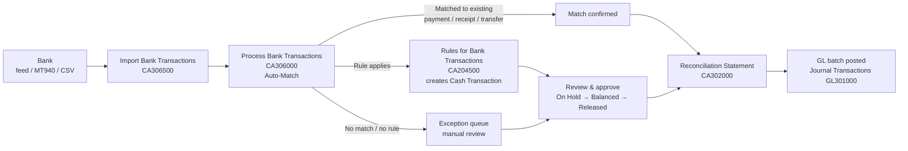

# SOP: Automated Accounting Entries from Bank Statements (Acumatica)

| Item | Detail |
|---|---|
| Document status | **DRAFT – Proposal for review** |
| Process owner | Finance Controller |
| System | Acumatica ERP – Cash Management (CA) module |
| Related SOPs | Treasury Transaction Journal Workflow, Bank Reconciliation, Month-End Close |
| Version | 0.1 |

> Screen IDs are those of recent Acumatica versions. Confirm them against your instance, because names and IDs can differ between versions and customisations.

---

## 1. Objective

Use Acumatica's built-in bank transaction processing to:

1. Import bank statements every day (bank feed or file).
2. Match bank lines automatically to transactions already in the cash book (AP payments, AR receipts, transfers, cash transactions).
3. **Create entries automatically** for bank-only items (charges, interest, withholding tax, sweeps) using rules.
4. Send anything that doesn't match or follow a rule to an exception queue for a person to handle.
5. Release entries only after review and approval, keeping the preparer separate from the approver.

In Acumatica, the **cash book** is the transaction register of each Cash Account. A separate Excel cash book is not needed once all treasury transactions are recorded in the CA, AP and AR modules.

## 2. Process Overview

## 3. One-Time Setup

| # | Setup item | Screen | Notes |
|---|---|---|---|
| 1 | Cash Management Preferences | CA101000 | Set matching settings: date range (e.g. ± 3 days before / 7 days after) and the weights for reference vs amount vs date. Turn on **Hold entries on entry** so new entries need review before release. |
| 2 | Cash Accounts | CA202000 | One per bank account and currency, linked to its GL account. Enable **Reconciliation** and set the statement import format. |
| 3 | Entry Types | CA203000 | Create one entry type per automated entry and link each to its offset GL account (table in Section 4). |
| 4 | Bank Feeds *(optional)* | CA205500 | Direct feed through a supported provider, if your banks are covered. Otherwise use file import (step 5). |
| 5 | Statement Import Format | Import Scenarios SM206025 / Data Providers SM206015 | Map MT940, CAMT.053 or the bank's CSV layout to bank transaction fields (date, amount, debit/credit, description, reference, payee). Set up one scenario per bank layout. |
| 6 | Rules for Bank Transactions | CA204500 | Create rules from the Section 4 table. Each rule matches on description text, amount range and debit/credit direction, and assigns an entry type. |
| 7 | Approval Maps *(if used)* | SM205000 / CA approval settings | Send automatically created cash transactions above the thresholds to the approvers in the Treasury SOP approval matrix. |
| 8 | Roles & access | SM201005 | Split roles: **Importer/Preparer** (import, match, create), **Approver** (release). The same user must not hold both for the same cash account. |

## 4. Proposed Automation Rules

The keywords below are examples. Take the exact descriptions from 2–3 months of real statements for each bank.

| Rule | Bank line condition | Entry type | Generated entry | Auto-release? |
|---|---|---|---|---|
| R01 Bank charges | Debit; description contains `CHG`, `COMM`, `SERVICE FEE`, `CHARGES` | `BANKCHG` | Dr Bank Charges / Cr Bank | Yes, if ≤ [small limit]; otherwise On Hold |
| R02 Interest received | Credit; contains `INT CR`, `INTEREST` | `INTINC` | Dr Bank / Cr Interest Income (or Interest Receivable after month-end accrual) | No – review |
| R03 Withholding tax | Debit; contains `WHT`, `W/TAX` | `WHT` | Dr WHT Recoverable / Cr Bank | No – review |
| R04 Overdraft / loan interest | Debit; contains `OD INT`, `LOAN INT` | `INTEXP` | Dr Interest Expense (or Interest Payable) / Cr Bank | No – review |
| R05 FD placement | Debit; contains `FD PLACEMENT`, `TD` + deal ref | `FDPLACE` | Dr Short-term Deposits / Cr Bank | No – review against Deal Ticket |
| R06 FD maturity | Credit; contains `FD MAT`, `TD MATURITY` | `FDMAT` | Dr Bank / Cr Short-term Deposits (+ Interest) | No – split the principal and interest on review |
| R07 Inter-account transfer | Contains own account number or `TRF`, `SWEEP` | Match to **Funds Transfer** (CA301000) | Dr Bank B / Cr Bank A | Matched only – create the transfer if it is missing |
| R08 Card / merchant settlement | Credit; contains acquirer name | `MERCHSET` | Dr Bank, Dr Merchant Fees / Cr Card Clearing | No – review |

**Lines that are never created by a rule. They must match an existing document or be raised manually:**
- Vendor payments → match to AP Payments
- Customer receipts → match to AR Payments, applied to invoices
- Loan drawdowns and repayments, FX deals, derivatives and intercompany funding → follow the Treasury Journal Workflow (Deal Ticket, confirmation, JE)

## 5. Daily Operating Procedure

| Step | Action | Owner | Screen | Timing |
|---|---|---|---|---|
| 1 | Import the previous day's statement for each cash account (or let the bank feed refresh) | Accountant | CA306500 / CA205500 | By 10:00 each day |
| 2 | Run **Auto-Match** | Accountant | CA306000 | After import |
| 3 | Check the suggested matches and confirm those with a high match score. Look into low-score suggestions before accepting them | Accountant | CA306000 | Same day |
| 4 | Run the rules for unmatched lines and check that the cash transactions created have the right entry type and amount | Accountant | CA306000 / CA304000 | Same day |
| 5 | Deal with exceptions: find the support, create the document manually, or log it in the Bank Exception Log | Accountant | CA304000 / AP / AR | ≤ 5 business days |
| 6 | Review and **release** the transactions On Hold according to the approval matrix | Finance Manager / Controller | CA304000 / approval inbox | T+1 |
| 7 | Confirm the GL batches are posted | Accountant | GL301000 | T+1 |
| 8 | Month end: complete the **Reconciliation Statement** for each cash account. Unreconciled balance = 0 or fully explained | Accountant → Finance Manager sign-off | CA302000 | By WD+3 |

## 6. Controls

| Ref | Control | Type | Evidence |
|---|---|---|---|
| ABE-C1 | Statements are imported from the bank feed or the bank's original file, never retyped | Preventive | Import log in CA306500 |
| ABE-C2 | Changes to rules, entry types and GL mappings need Controller approval and are logged | Preventive | Change log / Audit History |
| ABE-C3 | Only rule R01 (≤ [limit]) is auto-released. All other created entries stay On Hold until approved | Preventive | Transaction status history |
| ABE-C4 | Preparer ≠ releaser, enforced by roles | Preventive | Role matrix and quarterly access review |
| ABE-C5 | Weekly review of manually overridden matches and low-score matches | Detective | Signed report |
| ABE-C6 | Monthly reconciliation statement for every cash account, signed by the reviewer | Detective | CA302000 report |
| ABE-C7 | Monthly sample (e.g. 10) of automatically created entries tested against bank and support | Detective | Test sheet |
| ABE-C8 | Exception items open longer than 30 days escalated to the Controller | Detective | Exception log |

## 7. Rollout Plan

| Phase | Activities | Duration (indicative) |
|---|---|---|
| 1. Discovery | Collect 3 months of statements per bank; list the description patterns; agree entry types and GL mapping | 1–2 weeks |
| 2. Configure (Sandbox) | Import scenarios, entry types, rules, matching settings, roles | 1–2 weeks |
| 3. Parallel run | Run alongside the current manual process for one full month; compare match rate and accuracy | 1 month |
| 4. Go-live | Switch over by bank account; keep the manual fallback for the first close | — |
| 5. Tune | Review unmatched lines monthly and add or adjust rules | Ongoing |

**Target KPIs:** auto-match rate ≥ 80% of lines; created entries ≥ 90% correct without edits; reconciliations done by WD+3.

## 8. Open Decisions

1. Bank feed vs file import for each bank, depending on bank support and your Acumatica edition and licence.
2. The statement format available from each bank (MT940, CAMT.053 or CSV).
3. The auto-release limit for bank charges, if any.
4. Whether to use Acumatica approval maps for cash transactions or the On Hold + release-rights approach only.
5. Whether a customisation is needed. For example, if one bank line must be split into principal and interest automatically, that may need customisation or a manual split.

---

### Revision History

| Version | Date | Author | Change |
|---|---|---|---|
| 0.1 | 2026-10-10 | Finance | Initial draft proposal |
