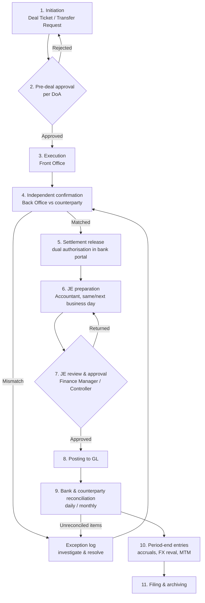

# SOP: Treasury Transaction Journal Workflow

| Item | Detail |
|---|---|
| Document status | **DRAFT – Proposal for review** |
| Process owner | Finance Controller |
| Applies to | Treasury, Accounting (GL), Finance Management |
| Related SOPs | Bank Reconciliation, Payment Authorisation, Month-End Close, Delegation of Authority |
| Version | 0.1 |

---

## 1. Purpose

To make sure every treasury transaction is:

1. Authorised before it is executed.
2. Independently confirmed with the counterparty.
3. Recorded in the general ledger (GL) completely, accurately and in the correct period.
4. Reconciled to the bank and counterparty statements.
5. Supported by documents that are available for audit.

## 2. Scope

The SOP covers the journal entries (JEs) for these treasury transactions:

| Category | Examples |
|---|---|
| Cash movements | Inter-bank transfers, sweeps, cash pooling, petty cash top-ups |
| Deposits & investments | Fixed / time deposits, money-market placements, maturities, rollovers |
| Borrowings | Loan drawdowns, repayments, revolving credit, overdrafts |
| Interest & fees | Interest income/expense, bank charges, commitment and arrangement fees |
| Foreign exchange | Spot FX conversions, forward contracts, period-end FX revaluation |
| Intercompany funding | Intercompany loans, capital injections, funding transfers |
| Hedging / derivatives | Forwards, swaps: inception, mark-to-market (MTM), settlement |

Out of scope: trade AP/AR payments and receipts, which follow the Payment Authorisation and Cash Receipts SOPs. Bank charges and interest that appear on those statements are still booked under this SOP.

## 3. Roles and Segregation of Duties

| Role | Responsibilities | Must NOT |
|---|---|---|
| **Treasury Officer (Front Office)** | Gets quotes, initiates and executes deals or transfers, completes the Deal Ticket | Confirm deals, prepare JEs or post to the GL |
| **Treasury Back Office / Settlement** | Independently confirms deals with counterparties and releases settlement instructions in the bank portal | Initiate deals |
| **Accountant (JE Preparer)** | Prepares JEs from confirmed deals and bank statements, attaches support, prepares reconciliations | Approve their own JEs or release bank payments |
| **Finance Manager / Controller (JE Approver)** | Reviews and approves JEs, approves reconciliations, approves manual adjustments | Prepare the JEs they approve |
| **CFO / Authorised Signatories** | Approve deals and payments above the thresholds in the Delegation of Authority (DoA) | — |

> **Small-team note:** If the team is too small for full segregation, at minimum the **preparer and approver of a JE must be different people**. The CFO should also review a monthly report of all treasury JEs as a compensating control.

## 4. End-to-End Workflow

### Step-by-step

| # | Step | Owner | Input | Output / Evidence | Timing |
|---|---|---|---|---|---|
| 1 | **Initiation:** complete the Deal Ticket or Transfer Request (counterparty, amount, currency, rate, value date, maturity, purpose, GL accounts) | Treasury Officer | Cash forecast, funding need | Deal Ticket (numbered `TRY-YYYYMM-####`) | Before the deal |
| 2 | **Pre-deal approval** according to DoA thresholds | Authorised approver | Deal Ticket | Approval signature or workflow stamp | Before execution |
| 3 | **Execution:** deal with the bank or counterparty, or create the transfer in the bank portal (maker) | Treasury Officer | Approved ticket | Bank or dealer reference | Deal date |
| 4 | **Independent confirmation:** match the counterparty confirmation to the Deal Ticket (amount, rate, dates, SSI) | Back Office | Counterparty confirmation | Signed confirmation-match checklist | Within 1 business day |
| 5 | **Settlement release** in the bank portal (checker or 2nd signatory) | Back Office / Signatories | Matched confirmation | Bank release log | Value date |
| 6 | **JE preparation** using the standard templates (Section 5) | Accountant | Deal Ticket, confirmation, bank advice or statement | Draft JE plus attachments | T+1 business day |
| 7 | **JE review & approval:** check the accounts, amounts, FX rate, period, support and DoA | Finance Manager / Controller | Draft JE pack | Approved JE (system approval or sign-off) | T+2 business days |
| 8 | **Posting** to the GL | Accountant (system-enforced after approval) | Approved JE | Posted JE number | On approval |
| 9 | **Reconciliation:** bank statement to GL every day for cash; deposits, loans and intercompany balances to statements every month | Accountant, reviewed by Finance Manager | Bank statements, loan or deposit statements | Signed reconciliations | Daily / by WD+3 |
| 10 | **Period-end entries:** interest accruals, FX revaluation, derivative MTM, loan classification (current / non-current) | Accountant, approved by Controller | Rate sheets, bank valuations | Period-end JEs plus schedules | WD+1 to WD+3 |
| 11 | **Filing:** store the JE pack under the JE number | Accountant | Approved JE pack | Archive (see Section 9) | On posting |

*T = transaction / value date; WD = working day after month end.*

## 5. Standard Journal Entry Templates

Fill in your own chart-of-accounts codes. Templates should be set up as **recurring or standard JE templates** in the ERP to reduce keying errors.

| Transaction | Debit | Credit |
|---|---|---|
| Inter-bank transfer (same currency) | Bank B | Bank A |
| Transfer in transit at period end | Cash in Transit | Bank A |
| Fixed deposit placement | Short-term Deposits | Bank |
| Fixed deposit maturity | Bank | Short-term Deposits; Interest Receivable / Interest Income |
| Interest income accrual (month end) | Interest Receivable | Interest Income |
| Withholding tax on interest received | WHT Recoverable / Tax Expense | Interest Receivable |
| Loan drawdown | Bank | Borrowings (current / non-current) |
| Loan repayment | Borrowings; Interest Payable | Bank |
| Interest expense accrual | Interest Expense | Interest Payable |
| Arrangement / upfront fee (effective interest) | Borrowings (deferred cost) | Bank |
| Bank charges | Bank Charges Expense | Bank |
| Spot FX conversion | Bank (currency bought) | Bank (currency sold); FX Gain/Loss (difference to book rate) |
| Period-end FX revaluation of FCY balances | Bank / Borrowings or FX Unrealised Gain/Loss | FX Unrealised Gain/Loss or Bank / Borrowings |
| FX forward / derivative MTM (no hedge accounting) | Derivative Asset or FV Loss (P&L) | FV Gain (P&L) or Derivative Liability |
| Intercompany loan granted | Intercompany Loan Receivable | Bank |
| Intercompany loan received | Bank | Intercompany Loan Payable |

**Required JE header fields:** JE type `TRY`, Deal Ticket number, value date, posting period, currency, FX rate and its source, description (`[Type] – [Counterparty] – [Ref]`), preparer and approver.

## 6. Approval Matrix (proposed – align to the company DoA)

| JE type / amount (base currency) | Approver |
|---|---|
| Routine: bank charges, auto-template interest, ≤ [Threshold 1] | Finance Manager |
| > [Threshold 1] and ≤ [Threshold 2] | Finance Controller |
| > [Threshold 2], all new borrowings, all derivatives, all intercompany funding | CFO |
| Manual adjustments or reversals of posted treasury JEs (any amount) | Finance Controller **plus** a reason code |
| JE posted to a prior or closed period | CFO |

## 7. Key Controls

| Ref | Control | Type | Frequency | Evidence |
|---|---|---|---|---|
| TRY-C1 | Deals approved per DoA before execution | Preventive | Each deal | Approved Deal Ticket |
| TRY-C2 | Back Office confirms deals independently with the counterparty | Detective | Each deal | Confirmation-match checklist |
| TRY-C3 | Dual authorisation (maker/checker) in the bank portal | Preventive | Each payment | Bank audit log |
| TRY-C4 | JE preparer ≠ approver, enforced by the ERP | Preventive | Each JE | ERP workflow log |
| TRY-C5 | Each treasury JE has a Deal Ticket, confirmation and bank advice attached | Preventive | Each JE | JE pack |
| TRY-C6 | Daily bank-to-GL cash reconciliation | Detective | Daily | Signed reconciliation |
| TRY-C7 | Monthly deposit, loan and intercompany balance confirmation and reconciliation | Detective | Monthly | Signed reconciliation and statements |
| TRY-C8 | Period-end FX rates taken from the approved source (e.g. central bank closing rate) and independently checked | Preventive | Monthly | Rate sheet with reviewer sign-off |
| TRY-C9 | Interest accruals recalculated independently by the reviewer | Detective | Monthly | Accrual schedule |
| TRY-C10 | Quarterly review of bank-portal user access and signatory lists | Preventive | Quarterly | Access review sign-off |
| TRY-C11 | Monthly review of the treasury JE listing (manual, reversed and late JEs) by the Controller/CFO | Detective | Monthly | Signed JE listing |

## 8. Exceptions and Error Handling

- **Confirmation mismatch:** log it in the Treasury Exception Log within the same day. Escalate to the Finance Controller if it is not resolved within 2 business days.
- **Unreconciled bank item:** investigate items older than 5 business days, and escalate any above [materiality]. Do not use a suspense account for more than 30 days.
- **Posted JE error:** do not edit or delete a posted JE. Post a reversing JE that references the original and then a corrected JE. Both need approval under Section 6.
- **Late or out-of-period JE:** needs Controller approval and is reported in the monthly JE review (TRY-C11).

## 9. Documentation and Retention

The JE pack, filed under the JE number, must contain:

1. Approved Deal Ticket or Transfer Request
2. Counterparty confirmation and the confirmation-match checklist
3. Bank advice, SWIFT/MT message or statement extract
4. Calculation workings (interest, FX, MTM)
5. Evidence of JE approval

Retention: keep for at least **[7] years**, or longer if local statutory requirements demand it, in the controlled finance repository with restricted access.

## 10. Timeline Summary (Month-End)

| Day | Activity |
|---|---|
| Daily | Post the previous day's treasury JEs and complete the cash reconciliation |
| WD-1 | Cut-off reminder to Treasury; all deals for the month confirmed |
| WD+1 | Bank statements obtained; interest accruals and FX revaluation prepared |
| WD+2 | Derivative MTM (bank valuations) booked; intercompany balances agreed |
| WD+3 | All treasury reconciliations signed off; JE listing reviewed (TRY-C11) |

## 11. KPIs

- Percentage of treasury JEs posted within T+2 (target ≥ 95%)
- Number of confirmation mismatches per month
- Age and value of unreconciled bank items
- Number of reversed or corrected treasury JEs
- Treasury reconciliations completed by WD+3 (target 100%)

## 12. Open Decisions for Reviewers

1. Set the approval thresholds [Threshold 1] and [Threshold 2] in base currency.
2. Choose the official FX rate source and timing (e.g. central bank closing rate, Bloomberg/Reuters 5pm).
3. Decide whether hedge accounting is applied (this affects the derivative JE templates).
4. Decide whether a treasury management system (TMS) will generate the JEs automatically, or whether they stay manual in the ERP.
5. Confirm local retention and withholding-tax requirements for each operating entity.

---

### Revision History

| Version | Date | Author | Change |
|---|---|---|---|
| 0.1 | 2026-10-10 | Finance | Initial draft proposal |
